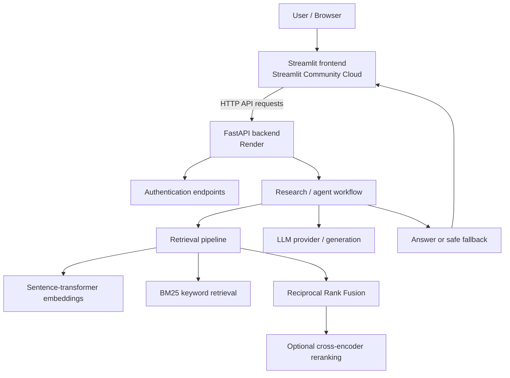

# Sahayak | Multilingual Citizen Companion

**Live demo:** https://sahayaka.streamlit.app/  
**Source code:** https://github.com/Shafhere/Sahayak  
**Backend API documentation:** https://sahayak-api-kfuk.onrender.com/docs  
**Backend health check:** https://sahayak-api-kfuk.onrender.com/health

Sahayak is a multilingual citizen-support application designed to help people explore government-scheme information and receive mentorship-style guidance. The deployed demo has two main modes:

- **Scheme mode:** helps users explore potentially relevant government schemes and understand what to investigate next.
- **Mentor mode:** provides learning and career-planning guidance, such as a structured roadmap.

> **Demo limitation:** Sahayak is a portfolio project, not an official government service. Treat generated information as guidance, not a final eligibility decision. Verify scheme rules, deadlines, required documents, and application procedures on official government sources before acting.

## Try the live demo

1. Open the [Sahayak app](https://sahayaka.streamlit.app/).
2. Choose **Mentor** or **Scheme** mode.
3. Enter a clear question with relevant context (for example, state, student level, course, or goal).
4. Submit the request and review the response.
5. For Scheme mode, verify important claims using official sources. If the verified knowledge base does not contain enough information, the app may show a fallback asking you to narrow the search.

### Example prompts

**Mentor mode**
- “I am 18 years old, interested in computer science, and want to become a data scientist. Create a practical six-month learning roadmap.”
- “I know basic Python. Suggest a beginner-friendly plan to learn machine learning.”

**Scheme mode**
- “I am a college student from Kerala. What scholarships should I investigate, and what eligibility criteria should I verify?”
- “I am looking for government support for a specific situation. Ask me the details you need before suggesting schemes.”

The demo may take time to respond if the backend is waking from inactivity. Free hosting does not guarantee uninterrupted availability.

## Architecture



The diagram represents the project architecture based on the code and deployment configuration reviewed during development. Exact execution paths can differ by mode and configuration. See [`docs/TECHNICAL_DOCUMENTATION.md`](docs/TECHNICAL_DOCUMENTATION.md) for implementation notes and items that should be verified against the current source.

## Technology stack

| Technology | Role in Sahayak | Why it is useful |
|---|---|---|
| Python | Main application language | Shared language for UI, API, and AI logic |
| Streamlit | Web UI | Fast way to build an interactive Python-based demo |
| FastAPI | Backend API | Typed request/response handling and generated OpenAPI docs |
| Uvicorn | ASGI server for the API | Runs the FastAPI application |
| Sentence Transformers | Text embeddings | Converts text into vectors for semantic retrieval |
| `BAAI/bge-small-en-v1.5` | Embedding model identified in the RAG code | Creates semantic representations of text |
| BM25 | Keyword-based retrieval | Finds exact terms that semantic search can miss |
| Reciprocal Rank Fusion | Retrieval-result fusion | Combines ranked results from different retrievers |
| Cross-Encoder | Reranking candidate passages | Re-scores retrieved candidates for relevance; can be disabled in low-memory hosting |
| Groq API (if configured) | LLM inference | Hosted inference without running a large generative model on the web service |
| pytest | Automated tests | Checks application behaviour and reduces regression risk |
| Git and GitHub | Source control and collaboration | Version history, pull requests, and repository hosting |
| GitHub Actions | Continuous integration | Runs automated checks on code changes |
| Docker | Container packaging for the Render frontend service | Reproducible runtime environment |
| Render | FastAPI backend hosting | Exposes the API publicly |
| Streamlit Community Cloud | Frontend hosting | Public URL connected to the GitHub repository |

Some dependencies or features may be optional or configuration-dependent. This table does not imply that every technology runs on every request.

## Repository map

The following paths are known from the project work; check the current repository for any changes.

```text
Sahayak/
├── app/
│   ├── agents/
│   │   └── research.py       # Research/retrieval orchestration
│   ├── api/
│   │   └── main.py           # FastAPI application entry point
│   ├── rag/
│   │   ├── embed.py          # Embedding model and text embedding
│   │   ├── rerank.py         # Cross-encoder reranking
│   │   ├── bm25.py           # Keyword retrieval
│   │   ├── rrf.py            # Reciprocal Rank Fusion
│   │   └── vector_store.py   # Vector retrieval interface
│   └── ui/
│       └── streamlit_app.py  # Streamlit interface
├── tests/                    # Automated tests (verify current path)
├── .github/workflows/        # CI workflow (verify current path)
├── requirements.txt          # Python dependencies (verify current path)
└── docs/
    └── TECHNICAL_DOCUMENTATION.md
```

## Run locally on Windows

### 1. Prerequisites

- Git
- Python version compatible with the repository's dependencies
- VS Code (recommended)
- API credentials required by the current configuration, if any

Use the Python version declared in the project configuration or CI workflow when available. Do not assume the Python version installed on the host is compatible with every ML dependency.

### 2. Clone the repository

```cmd
git clone https://github.com/Shafhere/Sahayak.git
cd Sahayak
```

### 3. Create and activate a virtual environment

```cmd
py -m venv venv
venv\Scripts\activate
python --version
```

If your existing local environment is named `.venv`, activate it with:

```cmd
.venv\Scripts\activate
```

### 4. Install dependencies

Use the repository's dependency file and setup instructions. If `requirements.txt` is present:

```cmd
python -m pip install --upgrade pip
pip install -r requirements.txt
```

If your local environment already works, you do not need to recreate it just to run the app.

### 5. Configure secrets

Create a local `.env` file only if the application expects one. Add the variables required by the code, for example an LLM API key if configured. **Never commit `.env`, API keys, JWT secrets, or production credentials.**

The deployed frontend and backend have separate configuration environments:
- Streamlit Community Cloud: configure required values in the app's **Settings → Secrets**.
- Render backend: configure required values in the service's **Environment** settings.

The frontend must read the backend URL using the configuration mechanism implemented in `app/ui/streamlit_app.py`. A secret name alone does not guarantee the code reads it; check the code before changing configuration.

### 6. Start the backend

From the repository root, with the virtual environment active:

```cmd
python -m uvicorn app.api.main:app --reload --host 127.0.0.1 --port 8000
```

If the entry-point path has changed in the current branch, use the module path specified by the repository's current deployment configuration.

Backend URLs when running locally:
- API docs: http://127.0.0.1:8000/docs
- Health: http://127.0.0.1:8000/health

### 7. Start the frontend

Open a second VS Code terminal, activate the same environment, and run:

```cmd
streamlit run app/ui/streamlit_app.py
```

Open the local URL printed by Streamlit, usually http://localhost:8501.

### 8. Smoke-test both modes

- Submit one learning/career question in Mentor mode.
- Submit one government-scheme question in Scheme mode.
- Confirm that a response appears and inspect both terminals for errors.
- A knowledge-base fallback is an expected safety behaviour when relevant verified material is not available; it is different from a crash.

## Testing and CI

The project has a GitHub Actions CI workflow and local pytest coverage. During development, the test command used was:

```cmd
python -m pytest -q
```

A previous local run reported **38 passed**. This is a historical result, not a guarantee that the current branch still passes. Re-run the tests after changes and check the latest GitHub Actions run.

To inspect CI:
1. Open the [GitHub repository](https://github.com/Shafhere/Sahayak).
2. Select **Actions**.
3. Open the latest workflow run for the branch or commit being reviewed.

## Deployment and troubleshooting

### Public URLs

| Component | URL | Purpose |
|---|---|---|
| Streamlit frontend | https://sahayaka.streamlit.app/ | Recruiter-facing demo |
| FastAPI docs | https://sahayak-api-kfuk.onrender.com/docs | Inspect available API endpoints |
| API health | https://sahayak-api-kfuk.onrender.com/health | Basic backend health check |
| GitHub | https://github.com/Shafhere/Sahayak | Source code and CI |

### If the app loads but no useful answer appears

1. Confirm that the backend health endpoint responds.
2. Check Streamlit Community Cloud logs for the request time.
3. Check Render backend logs for the same time.
4. Verify the frontend is using the correct backend URL.
5. Verify required LLM credentials are configured on the service that uses them.
6. Check whether the selected mode is appropriate for the question.
7. If the response is the knowledge-base fallback, inspect retrieval coverage and the indexed source data rather than treating it as a hosting failure.

### If Render is restarting

The project has used local embedding and cross-encoder models. Model loading can increase memory use substantially. The reranker has been made configurable with `SAHAYAK_USE_RERANKER`; set it to `false` only if the current deployed code supports that setting. Disabling reranking may lower retrieval quality. Check Render logs and actual deployed commit before concluding the issue is resolved.

### Free-hosting limitations

- Free services may sleep, restart, have limited CPU/RAM, or change their quotas.
- Cold starts can make the first request slow.
- This deployment is intended as a portfolio demo, not a service-level-agreement-backed production system.
- Avoid storing critical user data in ephemeral storage.
- Do not enter sensitive personal information into a public demo.

## Security and responsible use

- Keep API keys and signing secrets out of Git history and screenshots.
- Configure CORS and authentication according to the actual deployment requirements.
- Do not expose internal error traces to end users.
- Treat generated scheme guidance as informational, and verify it against official sources.
- Avoid collecting unnecessary personal data.
- Before real public use, add appropriate rate limiting, monitoring, persistent storage, and privacy controls.

## Known limitations and future improvements

These are recommendations, not claims that the features are already implemented:

- Add evaluation questions and measure retrieval precision/recall and answer faithfulness.
- Store verified scheme sources with update dates and citations.
- Add automated end-to-end tests for both Scheme and Mentor flows.
- Use persistent managed storage for user/account data where needed.
- Add rate limiting, structured logs, metrics, and alerts.
- Consider managed embedding inference or a lighter embedding model if local model memory is too high.
- Use a production database such as managed PostgreSQL rather than ephemeral SQLite for multi-user persistent data.
- Pin a compatible Python version and dependency versions.
- Add privacy notice, retention policy, and clear limitations to the public demo.

## Interview explanation

> Sahayak is a multilingual citizen companion with two user-facing modes: Scheme and Mentor. I built a Streamlit interface and a FastAPI backend, then deployed the frontend on Streamlit Community Cloud and the API on Render. The retrieval workflow combines semantic embeddings and keyword retrieval, fuses ranked results, and can rerank candidates with a cross-encoder. The application uses a fallback when the verified knowledge base cannot support a confident scheme response. I added automated testing and GitHub Actions CI. The current public deployment is a portfolio demo, and I understand the additional requirements for production, including persistent storage, monitoring, security hardening, and retrieval evaluation.

## License

See the repository's `LICENSE` file for the project's actual license. Do not claim a license unless the file is present and reviewed.

## Author

**Shafeer Saidalavi**  
GitHub: [@Shafhere](https://github.com/Shafhere)
