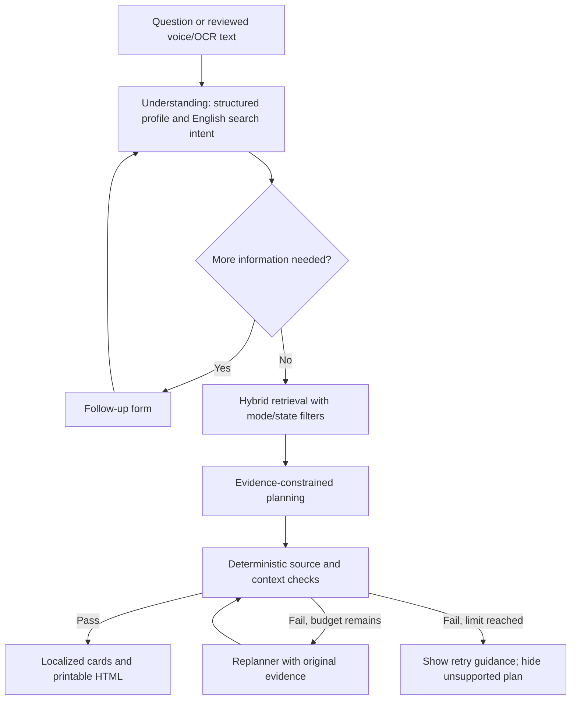

# Architecture and evaluation notes

## Data workflow

Official original → checksum and extraction check → page-aware passages → shared sparse/dense metadata → retrieval → canonical citation binding. Historical or low-quality legacy material is excluded rather than silently treated as valid. The raw corpus is not a labeled eligibility dataset; an eligibility classifier would require independently labeled decisions and a suitable evaluation design.

## What to explain in an interview

Explain the exact live failure: relevant files existed, but some were irrelevant or corrupted and the cross-encoder rejected the passages. Show the source audit, rebuilt index, follow-up regression, per-query scores, and a real cited output. Discuss remaining misses openly.

Use the actual saved results for numbers. Say "a developer-curated smoke test" rather than "100% accurate AI." Explain why source membership and verbatim quotation checks are useful but not a complete factual verifier. Mention CPU cold-start cost, source freshness, limited geographic coverage and the need for native-speaker review.

## Suggested demo

1. Open guest mode and choose Mentor.
2. Enter the original vague class-12 question; show that follow-up questions appear.
3. Provide biology/chemistry/physics and an interest in medicine.
4. Inspect a supported option, conditions, quote, original URL and page.
5. Download the HTML and use Print / Save as PDF.
6. Demonstrate a Kerala scheme question in Malayalam.
7. Show the evidence dashboard and an unsupported-topic result.

Do not use real identity documents or personal financial information in a public demo. A synthetic sample suffices.
